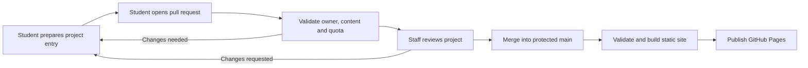

# AASE student project showcase design

Draft for discussion · October 7, 2026

Implementation note: this is the original proposal. The showcase implementation now exists;
see [README](../README.md) for implemented behavior and [setup](SETUP.md) for the
GitHub configuration runbook. Nothing in this proposal confirms
that a repository, deployment, or student participation policy has been activated.

Build a public project gallery at a proposed `/showcase/` endpoint, using the bold typography, maize/navy palette, wireframe illustration, and intro sequence from our local experiment. Keep the existing course homepage. Students submit project descriptions and images through pull requests; staff review and merge them; GitHub Actions publishes the gallery.

**The first version needs no application server or database.** GitHub holds the content and review history. Actions validates and builds it. GitHub Pages serves the finished pages. This supports the core experience we want: browse interesting work, open a project, see who made it, and try a demo.

The firm limit is **three projects per student**. This draft proposes three distinct projects per semester, with unlimited revisions to those entries. Whether students may replace projects is still a policy choice.

## What we are building

A course exhibition with the useful parts of a Devpost-style experience: project cards, screenshots, project stories, demo links, and maker profiles. A visitor should understand a project in ten seconds and have a clear route to explore it further.

The showcase publishes a presentation of each project. A demo can live on the student's own hosting, and source code can stay private. We do not run student applications on the showcase infrastructure or require students to publish private course repositories.

| Include in the first version | Leave for later |
| --- | --- |
| Gallery with search and a few useful filters | Accounts and an on-site dashboard |
| A permanent page for each accepted project | Direct publishing from a browser form |
| Public maker pages with up to three projects | Comments, voting, and leaderboards |
| Screenshots, optional video/demo/source links | Video uploads and application hosting |
| PR submission, validation, staff review | Automated judging or grading |
| Updates, withdrawals, and semester archives | Team ownership and cross-course submissions |

Publication is a showcase decision, separate from grading. The proposed first version is opt-in and supports a private course submission route for students who do not want their work displayed publicly. Staff must decide that participation policy before launch.

## The experience

Visual reference: [the existing local design experiment](http://127.0.0.1:8766/). Its design is the starting point for the showcase; it is not the published course homepage.

### Gallery

Use the experimental design as an exhibition entrance. Suggested heading: **BUILT BY AASE.** Keep the large condensed type, warm paper background, deep navy panels, and maize accents. Replace the course syllabus hero with student work and two actions: **Explore projects** and **Submit a project**.

The first screen should show actual projects, not a full-screen introduction followed by another full-screen hero. Use one featured project with a large screenshot beside the title, then the searchable gallery. Featured placement is editorial, with rotation across students; it is not a grade or popularity score. Until staff wants to curate, show all projects in a stable title order.

Each card contains a real project image, title, one-sentence description, maker, and up to three tags. Filters cover semester, project category, and tools. Search matches titles, summaries, makers, and tags. Put query/filter state in the URL so a filtered collection is shareable. Show a useful empty state with a clear-filter button.

Conceptual layout:

```text
AASE / SHOWCASE                    All projects   How to submit   Course ↗

BUILT BY                          [ Featured project screenshot          ]
AASE.                             [ Title · maker · view project         ]
Student projects in agentic software engineering

[ Search projects and makers... ]  [ Semester ]  [ Category ]  [ Tools ]

[ screenshot         ] [ screenshot         ] [ screenshot         ]
[ title              ] [ title              ] [ title              ]
[ one-line idea      ] [ one-line idea      ] [ one-line idea      ]
[ maker · tags       ] [ maker · tags       ] [ maker · tags       ]
```

### Project page

Lead with the title, maker, short pitch, cover image, and available actions: **Try the demo**, **Watch the walkthrough**, and **View source**. Omit missing links instead of showing disabled buttons.

The story answers five questions: What problem does it address? What did the student build? How was AI used? Which decisions did the student make and verify? What works today, and what remains limited? This last pair makes the gallery distinctive to AASE and gives visitors more substance than a stack of tool badges.

Include a small screenshot gallery, tool tags, last publication update, and a link to the maker's other work. Give every page a direct URL and share metadata. A command-line project can use terminal screenshots and a recorded walkthrough; a hosted web demo is optional.

### Maker page

Show the student's chosen public display name, optional short bio, GitHub link if desired, and up to three accepted projects. Do not publish a class directory of students who have not opted in. Do not show unused slots as missing coursework. The submission guide can explain how the student's three slots work without turning their public profile into a grade tracker.

### Motion and accessibility

Reuse the short AASE intro on a first gallery visit, with a visible skip button and replay control. Keep it under roughly two seconds, skip it for reduced-motion preferences, and never place it in front of direct project links. It is a brand sequence, not fake network progress.

The animated wireframe can remain in the gallery masthead. Student images should dominate the cards. Keep text visible without JavaScript, make filters keyboard accessible, preserve focus when results change, and use real links for navigation. Use three card columns on wide screens, two at intermediate widths, and one on phones. Self-host the chosen font files if their licenses permit it.

## Where it lives

Recommend a separate repository named `showcase` in the `eecs498-aase` organization, rather than adding student submissions to the course-site repository. GitHub's default project-site URL pattern would give us `https://eecs498-aase.github.io/showcase/`; the root course site stays at its existing address. This is a proposed address, not an endpoint that has been created. [GitHub Pages site types](https://docs.github.com/en/pages/getting-started-with-github-pages/what-is-github-pages)

A separate repository gives the showcase its own contributor workflow, review rules, build, and rollback history. Reserve `/showcase/` for that project site and keep generated links aware of that base path. The course homepage can later receive a single Showcase navigation link through its own reviewed change.

The easiest student workflow uses a **new public repository containing only showcase material**. The existing repository documentation says course repositories stay private, so this would be an explicit exception for an opt-in publication surface. It does not change the visibility of any existing repository. If public submission history is unacceptable, a private intake repository plus public export is possible, but adds access management and a separate publishing step.

| Approach | What it gives us | Tradeoff |
| --- | --- | --- |
| Separate showcase repository and Pages site | Independent PR workflow; original homepage stays intact | One more repository to maintain |
| `/showcase/` generated inside the course repository | One deployment and shared navigation | Student submissions share a repository with course maintenance; existing private access complicates contributions |
| Static frontend plus an API and database | On-site sign-in, private drafts, direct uploads | Authentication, storage, moderation, and service operations to build |

Start with the first option. Revisit an API only when an agreed feature needs it.

## How a project gets published



1. Staff verifies the student's GitHub account once through an existing private course channel and registers the student's chosen public identity.
2. The student forks the showcase repository, copies the template into an available slot, and adds images and project text. Provide both GitHub web-editor instructions and a local Git workflow.
3. The student opens a PR. A template explains public visibility and asks them to check the entry, images, and links before submission.
4. Automated checks report specific problems, such as a missing image, overlong summary, wrong owner, or occupied slot. First-time fork workflow runs may need staff approval before checks start. Check results are visible on the PR; the first version does not need a bot that posts comments.
5. A staff reviewer reads the project, checks the submitted material is suitable for publication, and merges after the required checks pass.
6. Actions rebuilds the gallery, project pages, maker pages, and search index. The project is public on the site after a successful deployment, not merely after opening or approving the PR.

An update follows the same workflow and keeps the project URL. A withdrawal goes through staff and hides the entry from the next site build. If the repository is public, the fork, PR, and Git history are already public before staff review. Unlisting a page does not erase those copies; students need to know that before submitting.

A later static submission helper can offer a form and live card preview, then download the JSON and images as a submission bundle. That improves authoring without introducing authentication. It cannot push a PR or authenticate a student by itself; the student still completes the GitHub step.

## Ownership and the three-project limit

### Proposed rules

| Situation | Treatment |
| --- | --- |
| First, second, or third distinct project in a semester | Accept into slots `01`, `02`, or `03` after review |
| Revision to an accepted project | Same slot and project ID; no additional slot |
| Unmerged or closed PR | Does not consume a published slot |
| Fourth project | Reject; show the student's existing entries in the check report |
| Withdrawn project | Hide it, but retain its occupied slot under the proposed distinct-project policy |
| Renamed project | Update display title; preserve its identity and URL |
| Materially different project placed over an old entry | Requires staff policy review; schema validation alone cannot detect this |
| Another semester | A new three-project allowance |

The alternative is three visible slots with replacements allowed. That needs different withdrawal/replacement rules, but the frontend and overall architecture stay the same. Keep the chosen rule in one trusted policy configuration and in the submission guide.

Use a numeric GitHub account ID as the ownership key, with one verified account per student per semester. Display names and GitHub handles are presentation fields, not proof of ownership. GitHub documents its account ID as durable even when the login changes. [GitHub user IDs](https://docs.github.com/en/rest/users/users#get-a-user-using-their-id)

For ordinary student PRs, compare the PR author's ID (`pull_request.user.id`) with the registered owner and the paths being changed. Do not infer the owner from commit email, a form field, or the account rerunning the workflow. Account migrations and staff submissions on behalf of a student use a separate reviewed staff process. Enrollment checks and account-identity mappings stay in private course records; the public registry includes only participating accounts and their approved public names.

Validate the complete candidate merged dataset, not just the new file. Two PRs can each appear to fit an allowance when checked against an old base. Require checks against the current base before merging, revalidate the full dataset before deployment, and prohibit ordinary student edits to occupied-slot identities or withdrawal records. Fixed slot paths also make competing submissions for the same slot conflict instead of quietly creating another entry.

## Content structure

Keep student contributions as structured data and raster images. A small static generator can turn them into escaped HTML templates and a JSON search index, using the existing experimental CSS and JavaScript as the visual starting point. There is no need to rewrite the course site or introduce a full application framework for this version.

Proposed repository structure:

```text
showcase/
  participants/f26.json                    # Staff-controlled opt-in identities
  policy/showcase.json                     # Staff-controlled limits and rules
  policy/publication.json                  # Staff-controlled withdrawals and exceptions
  projects/f26/<github-id>/01/
    project.json
    cover.webp
    screenshot-01.webp
  projects/f26/<github-id>/02/...
  projects/f26/<github-id>/03/...
  templates/project.json
  site/                                   # Staff-controlled templates, CSS and JS
  scripts/validate.mjs
  scripts/build.mjs
  .github/CODEOWNERS
  .github/workflows/validate.yml
  .github/workflows/publish.yml
  dist/                                   # Generated Pages artifact, not student input
```

Example content below is fictional. IDs and paths illustrate the shape; they do not register a real student.

```json
{
  "schemaVersion": 1,
  "projectId": "f26-12345678-01",
  "ownerId": 12345678,
  "cohort": "f26",
  "slot": "01",
  "title": "Patch Notes",
  "summary": "A review assistant that explains a code change and checks its claims against the diff.",
  "category": "Developer tools",
  "tags": ["Code review", "Agents"],
  "tools": ["Python", "Codex"],
  "cover": {
    "src": "cover.webp",
    "alt": "A code diff beside a plain-language explanation of the changed behavior"
  },
  "story": {
    "problem": "Reviewers need to understand intent before assessing an unfamiliar change.",
    "built": "A tool that pairs a change summary with links to the relevant lines.",
    "aiUse": "A model proposes an explanation using the supplied diff as context.",
    "humanDecisions": "I chose the evidence format and wrote checks for unsupported claims.",
    "limitations": "It currently handles small Python changes and still needs human review."
  },
  "links": {
    "demo": "https://example.com/demo",
    "video": null,
    "source": null
  }
}
```

Suggested initial bounds: title 60 characters, summary 160 characters, up to three topic tags, up to six tools or languages from a curated vocabulary, up to five images including the cover, and at most 2,000 characters per story field. These are design defaults to test with real submissions. Require meaningful alt text, allow only local JPEG/PNG/WebP files, and start with a 1 MB source-image limit. Generate smaller card variants and strip image metadata during the build. Original uploads remain visible in public PRs and Git history, so students must remove sensitive content and metadata before submitting; build-time cleanup only protects the deployed variants.

No student HTML, scripts, MDX, SVG, dependency files, or build commands. Escape strings and validate link schemes. Treat external demos as links; do not embed arbitrary iframes or fetch arbitrary URLs during the build. Source code and video links are optional. A documented project with screenshots is a valid submission even when it cannot provide a public demo.

Record withdrawals in staff-controlled `policy/publication.json`, keyed by project ID, with owner, semester, slot, and publication state. Staff can remove the project files from the current tree while retaining this minimal record. Count occupied slots across the union of project records and withdrawal records, deduplicated by project ID. Student PRs cannot reuse a withdrawn slot under the proposed policy. Omit withdrawn entries from project pages, gallery cards, maker listings, search data, and deployed assets. This removes current site content without promising erasure of public history.

Generate paths such as `/showcase/f26/projects/12345678-01/` and `/showcase/f26/makers/12345678/`. Derive maker names from the protected registry, publication timestamps from trusted merge history, and any featured flags from staff configuration. Keep the public search index limited to published fields. Browsing should not depend on a runtime GitHub API call.

## Validation and publishing

Use two workflows with different permissions:

- **PR validation:** an ordinary `pull_request` workflow with read-only permissions and no secrets. Run trusted validation code from the base branch against submitted data. Check the path allowlist, registered owner, schema, images, slot identities, and the complete candidate dataset. Do not install or execute code from a student submission.
- **Publication:** a workflow triggered by changes to protected `main`. Revalidate, build to `dist/`, and deploy only that artifact. Restrict Pages deployment permissions to the deployment job. Keep the last successful site when validation or building fails.

Protect the registry, policy, templates, validators, workflows, and `CODEOWNERS` with staff review. A student content PR cannot approve its own identity or change its validator. Because a PR can also propose workflow edits, a green check alone is insufficient: staff must verify the changed paths before approval, and infrastructure changes must use a separate staff-reviewed PR. Avoid privileged `pull_request_target` workflows that check out or run student code. [GitHub workflow events and fork permissions](https://docs.github.com/en/actions/reference/workflows-and-actions/events-that-trigger-workflows#pull_request), [GitHub guidance on pull_request_target](https://docs.github.com/en/actions/reference/security/securely-using-pull_request_target)

Require staff approval, the uniquely named validation check, up-to-date branches, and renewed approval after relevant changes. Apply protections to normal maintainer merges too. A merge queue can be considered later; if used, add `merge_group` validation for its combined candidate tree. Workflow concurrency alone does not enforce a project quota. [Protected branches](https://docs.github.com/en/repositories/configuring-branches-and-merges-in-your-repository/managing-protected-branches/about-protected-branches)

GitHub supports custom static-site builds and Pages artifact deployment. Set one production deployment concurrency group and ensure a superseded build cannot publish an older revision after a newer one. Confirm the repository's Pages source and deployment environment during implementation. PR previews are an optional later feature; the first version can provide a build artifact for staff to inspect locally. [Custom Pages workflows](https://docs.github.com/en/pages/getting-started-with-github-pages/using-custom-workflows-with-github-pages)

## Size and maintenance

Keep videos off Pages and optimize screenshots. As a planning example, 100 participating students × 3 projects × 3 images × 200 KB is about 180 MB of image content. This is an estimate, not a course enrollment count or a promised media budget. GitHub currently limits the published site to 1 GB, so check artifact size in CI and set an internal warning threshold below that limit. [GitHub Pages limits](https://docs.github.com/en/pages/getting-started-with-github-pages/github-pages-limits)

Archive by semester using the same URLs. Staff should have a short guide for approving a PR, explaining a validation failure, unlisting a project, correcting a student's account mapping, and restoring a previous successful build. External links can decay; report failures for staff review without blocking the entire gallery on a temporary demo outage.

## First implementation slice

1. Build the gallery, one project page, and a maker page using clearly labeled fictional fixtures. Reuse the visual experiment, with the course homepage untouched.
2. Define the schema, three-slot policy, trusted identity registry, static generator, and publication rules together. Write the student submission guide and template.
3. Exercise validation and local builds with representative PR data, then configure the repository protections and verify the actual PR workflow before opening submissions.
4. Pilot with a small opt-in group, then refine the authoring steps and review workload before a course-wide launch.

Acceptance checks should include a valid submission, an unauthorized owner, a fourth project, two competing PRs, attempts to edit policy or another student's images, a withdrawal followed by a new submission, a normal project update, invalid image content, unsafe URLs, and a failed build preserving the prior site. Verify direct project links, the `/showcase/` base path, search/filter URLs, mobile cards, keyboard navigation, reduced motion, and readable content without JavaScript.

## Decisions still open

| Decision | Starting proposal |
| --- | --- |
| Meaning of the cap | Three distinct projects per student per semester; revisions allowed |
| Public participation | Opt-in, with an equivalent private course route |
| Public source code | Optional; never require publication of private course code |
| Repository visibility | A separate public showcase-only repository, subject to the course's repository policy decision |
| Publication approval | One staff review plus required validation; no automatic publication from an unreviewed PR |
| Ownership | Individual projects initially; reconsider how every member's quota counts if teams are introduced |
| Featured work | Equal gallery visibility first; editorial rotation if staff wants featured projects |
| Naming | AASE Showcase, with the experimental visual identity |

The next useful prototype is a gallery with a few believable sample projects and one complete project story. That will tell us whether the design makes student work easy to understand before we spend time automating publication.
